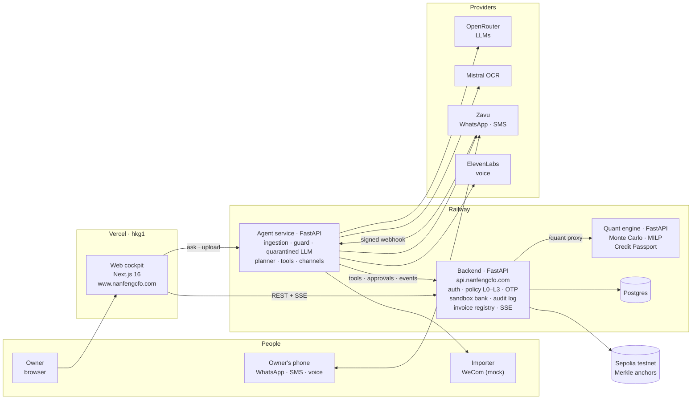
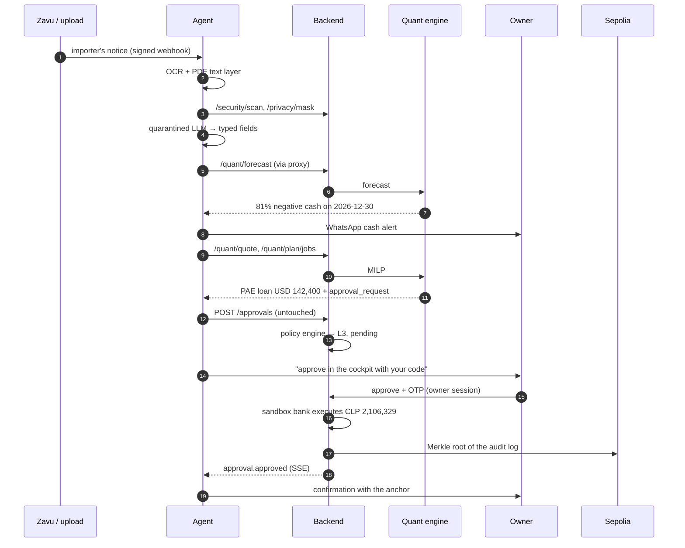

# NanFeng 南风 · Technical documentation (deliverable 01)

**The autonomous CFO for SMEs that export to China.** FinTechathon 2026 · International Track · Topic E: SME Finance Copilot.

NanFeng is an AI agent that acts as a financial participant for a small exporter: it reads what reaches the owner (an importer's late-payment notice, a supplier invoice), forecasts cash with a Monte Carlo engine, finds the cheapest financing with an exact optimizer, and executes it in a sandbox bank once the owner approves with a one-time code. The LLM never calculates and never decides: numbers come from deterministic tools, and a policy engine outside the LLM decides what the agent may do alone.

This document covers the three parts the competition asks for: **system architecture** (section 2), **core algorithm description** (section 3, with the agent in section 4) and **security design** (section 5). Each section links to the full write-up by the module's owner.

| | |
|---|---|
| Live app | [www.nanfengcfo.com](https://www.nanfengcfo.com/) |
| API (OpenAPI docs) | [api.nanfengcfo.com/docs](https://api.nanfengcfo.com/docs) |
| Source code | [github.com/Lilvecp/nanfeng](https://github.com/Lilvecp/nanfeng) |
| Data | All companies, customers, invoices, lenders and approvals are synthetic |

## Contents

1. [What NanFeng does](#1-what-nanfeng-does)
2. [System architecture](#2-system-architecture)
3. [Core algorithms](#3-core-algorithms)
4. [The agent](#4-the-agent)
5. [Security design](#5-security-design)
6. [Testing and validation](#6-testing-and-validation)
7. [Known limitations](#7-known-limitations)
8. [Detailed sections](#8-detailed-sections)

## 1. What NanFeng does

A Chilean cherry exporter pays harvest wages in pesos every month but is paid in USD or CNY 60–90 days after shipping, by importers who are sometimes late. One late invoice can leave the company unable to pay its payroll. Topic E asks for financing-option matching, cash-flow management with alerts and business financial analysis; NanFeng covers them as one loop:

| Topic E | How NanFeng does it | Where |
|---|---|---|
| Cash-flow management with alerts | 90-day Monte Carlo forecast (10,000 paths) of every inflow and outflow; the agent alerts the owner on WhatsApp when the probability of negative cash jumps, and sends a daily voice briefing | `vicente-rodriguez/nanfeng_quant`, `renato-lenis/nanfeng_agent` |
| Financing-option matching | Chance-constrained MILP over a catalog of 9 Chilean financing products (two kinds of export factoring, letter-of-credit discounting, confirming, a bank loan, a FOGAPE-guaranteed loan, a USD pre-export loan, a credit line, a CNY forward); compared fairly with the default bank loan | `vicente-rodriguez/nanfeng_quant`, web `/financing` |
| Business financial analysis | Business health: 90-day cash budget by month, where the money goes, customer concentration, DSO and aging, currency exposure with a peso shock, payroll safety, and plain findings in EN / ES / 中文, also sent to the owner on WhatsApp. Plus the Credit Passport (a six-factor score a lender can recompute) and the Scenario Lab | `vicente-rodriguez/nanfeng_quant/analysis.py`, web `/health`, agent `POST /report` |
| Acting, not advising | The agent proposes the plan as an approval request; the policy engine tiers it; the owner approves with a code; the sandbox bank executes it; the audit log is anchored on a public chain | `backend/app` |

**The reference scenario, Cherry Crisis** (Huerto Austral Export SpA, fictional). Every number below comes from one run of the quant engine (seed 7, 10,000 paths) and is shared by the web, the agent, the tests and the evidence.

| Step | Result |
|---|---|
| Before the notice | 13% probability of negative cash within 90 days |
| Shanghai Hongxin will pay INV-2026-118 (USD 180,000) 45 days late | **81% probability of negative cash on 2026-12-30**, the day of the CLP 238M harvest payroll |
| Products checked | 9 (7 eligible) |
| Plan | 60-day USD pre-export loan (PAE) of USD 142,400 |
| Cost | **CLP 2,106,329 vs CLP 3,796,513** for the default bank loan (45% cheaper) |
| After the plan | 96% of 10,000 paths stay above the buffer; Credit Passport 34 (E) → 67 (B) |
| Execution | L3 approval with the owner's code; the bank executes exactly CLP 2,106,329; the audit root is anchored on Sepolia |

## 2. System architecture

### 2.1 Components



| Component | Directory | Stack | Responsibility |
|---|---|---|---|
| Web cockpit | `web/` | Next.js 16, React 19, TypeScript, Tailwind 4 | Landing, owner's simple view and full desk (Cockpit, Business health, Approvals, Financing Arena, Scenario Lab, Mission Control, Security, Channels, Documents, Settings, Demo Mode), EN / ES / 中文. Runs on the live API, or on the Cherry Crisis sandbox in the browser when no API is reachable |
| Backend (API gateway) | `backend/` | FastAPI, SQLAlchemy, Postgres (SQLite locally), web3.py | Owner sign-in, policy engine L0–L3, step-up OTP, sandbox bank (accounts, payments, FX, factoring, loans, forwards), hash-chained audit log with Merkle anchoring, invoice registry, security endpoints (document guard, payee check, PII masking), agent event stream (SSE), proxy to the quant engine |
| Agent service | `renato-lenis/` | FastAPI, OpenRouter, Mistral OCR, Zavu, ElevenLabs | Reads documents and messages, plans, calls tools, proposes approvals, resumes a run when the owner decides, explains its decisions, talks to the owner and the importer |
| Quant engine | `vicente-rodriguez/` | NumPy, SciPy, pandas, OR-Tools (CBC, SCIP) | Cash Monte Carlo, financing MILP, plan explanations, Credit Passport, business financial analysis, NanFeng-Bench, backtest, sensitivity |
| Contracts | `contracts/` | OpenAPI 3 | `openapi.json` is generated from the backend; CI fails if it drifts. The web's types are generated from it |
| Security tooling | `andy-villarroel/` | Python | Threat model, red team (46 attacks), evidence package builder (deliverable 06) |
| Design | `design/private-desk/` | Static HTML | The mockups the web is built from |

### 2.2 Deployment

| Piece | Host | Address |
|---|---|---|
| Web | Vercel, region `hkg1` (Hong Kong, close to the jury), own domain | `https://www.nanfengcfo.com` |
| Backend | Railway (container from `backend/Dockerfile`), own domain | `https://api.nanfengcfo.com` |
| Agent service | Railway (container from `renato-lenis/Dockerfile`) | Railway public URL; the web reaches it through `NEXT_PUBLIC_AGENT_URL` |
| Quant engine | Railway (container from `vicente-rodriguez/Dockerfile`), listening on Railway's private network | the web and the agent call it through the backend's `/quant` proxy |
| Database | Postgres | `NANFENG_DATABASE_URL` |
| Chain | Sepolia (EVM testnet) through a public RPC | anchors readable on Etherscan |

The same four services run on one machine with `docker compose up --build` (section 2 of the [deployment guide](deployment.md)). Secrets live only in the hosts' environment variables; `.env.example` lists every variable with a safe default.

China access: fonts, the globe library and its textures are bundled (no Google Fonts or CDN at runtime), there are no analytics or reCAPTCHA, and the web is served from Hong Kong on a domain that is not `*.vercel.app`.

### 2.3 End-to-end flow (Cherry Crisis)



Every agent step is published on the backend's event stream (`agent.step`, with tool, tier, model, cost and latency), so Mission Control shows the run live. Demo Mode replays the same six steps through the real API (`POST /demo/step/{1..6}`), so the video and a live session show the same thing.

### 2.4 How money moves

Nothing calls the bank directly. Every operation is posted to `POST /approvals` as `{action, operations: [{op, params}, ...]}` (1–5 operations: `payment`, `fx_convert`, `factoring`, `loan`, `forward`). The backend computes the CLP exposure, asks the policy engine for a tier, and then executes immediately (L1, L2), waits for the owner (L3) or refuses (blocked). Execution writes the transactions, appends to the audit log and publishes events; an approved L3 request is anchored at once. Details: [`backend/README.md`](../backend/README.md#how-money-moves).

### 2.5 Extension points

The architecture keeps every external dependency behind one interface, so new rails plug in without touching the agent or the policy engine:

| Interface | Today | Adding one more |
|---|---|---|
| Anchoring backend (`backend/app/anchoring.py`) | `local`, `evm` (Sepolia) | another backend class, e.g. FISCO BCOS; same Merkle format |
| Invoice registry (`backend/app/registry.py`, `backend/chain/InvoiceRegistry.sol`) | `local`, `evm`; contract compiled for EVM version london so it also runs on older EVM chains | deploy the contract on another chain and set its address |
| Channels (`renato-lenis/nanfeng_agent/channels/`) | Zavu (WhatsApp, SMS, email, voice), ElevenLabs, WeCom mock | a new `ChannelAdapter` |
| Planner (`renato-lenis/nanfeng_agent/planner.py`) | LLM planner checked against the facts, rule planner as fallback | any model through OpenRouter (`NANFENG_MODEL_PLAN`) |
| Financing catalog (`vicente-rodriguez/nanfeng_quant`) | 9 products | a product is data plus its cash-effect rule |
| Sandbox bank operations (`backend/app`) | payment, FX, factoring, loan, forward | a new `op` goes through the same policy engine |

## 3. Core algorithms

Full description with assumptions and results: [`vicente-rodriguez/docs/core-algorithm.md`](../vicente-rodriguez/docs/core-algorithm.md). Financial catalog and sources: [`financial-catalog.md`](../vicente-rodriguez/docs/financial-catalog.md).

### 3.1 Cash Monte Carlo (90 days)

Opening cash, a buffer, receivables, planned shipments and payables in CLP, USD or CNY are simulated on N = 10,000 paths with a fixed seed. Per path:

- **Payment delay** of customer c: `D = (1 + m_c)·exp(σ_c·Z) − 1` (lognormal, floored at 0), plus any announced delay; **default** with probability p_c.
- **FX**: daily CLP/USD and CLP/CNY log-returns resampled jointly with a stationary block bootstrap (mean block 10 days) from 5 years of real data (Banco Central de Chile, FRED).
- **Cherry price**: one factor per path, mean 1, on every shipment not yet invoiced.
- **Parameter uncertainty** (τ = 0.5) and **systemic delays** (ρ = 0.6, a common factor across customers) fatten the tails; both were chosen on the backtest.

Outputs: P10/P50/P90 per day, `P(cash < 0)` per day and cumulative, the crunch day (first day with `P(cash < 0) ≥ 50%`). Counterfactual re-runs with common random numbers attribute the risk to each factor ("if Shanghai paid on time: 1%").

### 3.2 Financing optimizer (chance-constrained MILP)

Decisions: the fraction of each invoice factored on a day, the amount and term of each loan draw, payables extended by confirming, CNY forward notionals. Every lever changes the cash of each scenario linearly, so the problem is a mixed-integer linear program over S = 200 sampled scenarios (scenario approximation, Luedtke & Ahmed 2008):

```latex
\min_{x,w,z}\ \sum_v \mathrm{cost}_v\,x_v + \sum_{o} \mathrm{fee}_o\,w_o
\quad \text{s.t.} \quad
C_s(t) + \sum_v A_{v,s}(t)\,x_v \ \ge\ B - M_{s,t}\,z_s \ \ \forall s,t, \qquad
\sum_s z_s \le \lfloor \alpha S \rfloor
```

plus one operation per invoice, minimum tickets and fixed fees (binary w), credit lines, collateral, and at most 5 operations (the owner approves on a phone). It is solved with OR-Tools (CBC, SCIP as fallback) after a heuristic MIP start; the plan is then replayed on all 10,000 paths and re-solved tighter if fewer than 90% stay above the buffer. The plan is compared with the **default bank loan solved by the same MILP with the same freedom of term**, and the bank rate is set below the market average, so the savings are a lower bound. For each product the engine explains why it was chosen or not (re-solve without it, eligibility, lead time).

### 3.3 Credit Passport

A transparent scorecard of six factors (probability of negative cash, buffer in months of payroll, customer concentration, weighted customer delay, debt service over inflows, foreign-currency share), each mapped linearly to 0–100 and weighted 30/15/20/15/10/10. Every factor reports its value, sub-score and points, so a lender can recompute it. The weights are heuristic and labelled as such; the improvement after the plan holds under 10,000 random weightings.

### 3.4 Business financial analysis

Built from the same receivables, shipments and payables as the forecast, with no new assumption: a *contracted* 90-day calendar (each invoice paid at its due date plus any announced delay plus the customer's median delay, at today's FX) gives the cash budget by month, outflows by category, the operating cash margin, each customer's share of inflows and the concentration index, DSO (open receivables over daily sales) with an aging table, the exposure per currency with the effect of a 10% stronger peso, and the cash before each payroll. The Monte Carlo adds the probability that cash is negative after each payroll. Fixed thresholds turn this into plain findings in EN / ES / 中文, most severe first (for the Cherry Crisis: the December payroll at 81% risk, one customer at 58% of inflows, 100% of inflows in foreign currency, DSO 68 days; debt service at 4% is reported as healthy). The contracted calendar is the same independent ledger NanFeng-Bench checks against, and a test asserts they agree. Details: [core algorithm §6](../vicente-rodriguez/docs/core-algorithm.md#6-business-financial-analysis).

### 3.5 Validation

| Check | Result |
|---|---|
| NanFeng-Bench: 50 scenarios with a known answer (40 stochastic, judged by an independent 50,000-path oracle; 10 deterministic, against a hand-written ledger) | **50/50**; the 25 plans built are 41% cheaper than the bank loan on average |
| Rolling-origin FX backtest on real data 2018–2026 (204 origins) | P10–P90 covers 79–83% (nominal 80%) |
| Cash backtest against synthetic truth | CRPS 32–39% better than a point forecast; Brier skill +53% to +62% for "will we breach the buffer" |
| Sensitivity | savings stay 30–50% under ±30% on every rate, a missing product and confidence targets from 80% to 97.5% |

## 4. The agent

Full description: [`renato-lenis/docs/agent.md`](../renato-lenis/docs/agent.md).

The agent **proposes and never approves**. Its pipeline for every document or message:

1. **Ingestion:** Mistral OCR plus the PDF's own text layer (to catch hidden text).
2. **Guard:** `/security/scan` before any LLM reads the text; a malicious document stops here and the owner is alerted on another channel.
3. **Masking:** personal data replaced with placeholders (`/privacy/mask`).
4. **Quarantined LLM:** a small model with no tools and no memory returns typed fields only (strict schema, random boundary markers per call, temperature 0).
5. **Payee check:** bank account and sender domain against master data (business email compromise).
6. **Planner:** an LLM through OpenRouter (Claude Sonnet, with fallbacks) proposes tool calls; every step is checked against the facts and the rule planner takes over if any check fails.
7. **Tools:** `ledger_query`, `forecast_run`, `business_analysis`, `financing_quote`, `optimize_plan`, `propose_plan`, `send_collection`, `schedule_payment`, `request_factoring`, `anchor_audit`. No tool takes a bank account, a phone number, an approval code or free text for a person.
8. **Approval and resume:** money only moves through `POST /approvals`; when the owner decides, the agent's listener on the event stream resumes the run, anchors and confirms.

No outbound message is written by an LLM: every message comes from a template in EN / ES / 中文 with typed slots, and messages to importers carry an AI-generated label. "Ask it why" answers from the run's recorded tool results. Hard caps per run (12 steps, USD 0.50 of LLM spend) and the kill switch are checked before every step. Without provider keys every component has a deterministic stand-in, so CI and the demo never depend on a paid API; on the deploy all four providers are live.

## 5. Security design

Full description: [`andy-villarroel/docs/security-design.md`](../andy-villarroel/docs/security-design.md) · [threat model](../andy-villarroel/threat-model.md) · [anti-injection design](../andy-villarroel/anti-injection-design.md) · [privacy and compliance](../andy-villarroel/privacy-compliance.md) · [self-assessment (deliverable 05)](../andy-villarroel/security-self-assessment.md).

The design starts from one assumption: **the LLM will eventually be fooled**, so it is never the component that decides.

| Level | Meaning | Examples | Who acts |
|---|---|---|---|
| L0 | Read only | ledger, forecast, quotes, optimizer | Agent |
| L1 | Act and notify | payment ≤ CLP 1M to an allowlisted payee | Agent; owner notified |
| L2 | Act within limits | ≤ CLP 25M per action; agent spend ≤ CLP 40M / 24 h and ≤ CLP 80M / 30 days | Agent |
| L3 | Owner session + one-time code | financing, FX forwards, new payee, bank-account change, anything above an L2 limit | Owner |
| Blocked | Not from the app | > CLP 400M per action or per 30 days, sanctions match, kill switch on | Nobody in NanFeng |

Controls, each outside the LLM:

- **Policy engine** (`backend/app/policy.py`): a pure function of the request, the history and the clock; limits are data (`GET /policy`) and every decision records the rules that fired and the policy version. Velocity, split-payment (structuring) and recent-account-change rules escalate to L3. Decision and execution run under one lock.
- **Step-up authentication**: HMAC-signed owner session; per-approval SMS code bound to the approval and its amount (5 minutes, single use, never logged, never seen by the agent); three wrong codes lock the approval; one decision per approval even across channels; voice never approves L3; the kill switch is stored in the database and only the owner with a code can turn it off.
- **Document guard and payee check**: deterministic rules for instructions addressed to an AI, hidden text, invisible characters, encoded payloads and urgency; bank-account changes and look-alike domains answered with the call-back number on file.
- **Privacy**: PII masked before any LLM call; accounts and phones masked in logs; synthetic sanctions screening; Chile (Ley 21.719) and China (PIPL, generative-AI measures) mapped in the compliance doc.
- **Tamper evidence**: `hash_n = SHA-256(prev_hash | seq | ts | actor | kind | payload)`; Merkle roots anchored on Sepolia with calldata `NANFENG1 | root | from_seq | to_seq`; inclusion proofs per entry; the evidence package re-checks everything without the backend's code.
- **Double financing**: every invoice that backs a payout is registered by fingerprint first (local table and, in `evm` mode, the `InvoiceRegistry` contract); factoring fails closed if the registry cannot be read.

Result: the red team's first 43 outcome-based attacks went from 4/43 stopped to 43/43; 3 more added on Oct 14 (duplicate loan approvals, a spoofed late-payment notice) got through until that day's fixes. Today **46/46** are stopped, and CI fails the build if one gets through; 21 attacks replayed through the real agent move no money.

## 6. Testing and validation

| Suite | Count | Run | In CI |
|---|---|---|---|
| Backend (security, policy, API, sign-in, OTP, privacy, registry, anchoring, demo) | 116 | `cd backend && pytest -q` | Backend tests |
| Red team gate (46 attacks against the API) | 46/46 stopped | `cd backend && python ../andy-villarroel/redteam/run.py --backend . --label local --min-stopped 46` | Backend tests |
| OpenAPI contract drift | — | `cd backend && python -m app.main ../contracts/openapi.json && git diff --exit-code ../contracts/openapi.json` | Backend tests |
| Agent (pipeline, Cherry Crisis, service, health report, red team through the agent, AI label) | 91 | `cd renato-lenis && pytest -q` (needs `../backend[dev]`) | Agent tests |
| Quant engine (Monte Carlo, MILP, business analysis, bench, API) | 36 | `cd vicente-rodriguez && pytest -q` | Quant tests |
| NanFeng-Bench | 50/50 | `python -m nanfeng_quant bench` (~5 min) | No (results committed) |
| Web | lint + production build | `cd web && npm run lint && npm run build` | Web lint and build |
| Secret scanning | gitleaks | — | Secret scanning |

Execution evidence (deliverable 06) is produced from a running backend with `andy-villarroel/evidence/build.py` and committed in [`andy-villarroel/evidence/out-live/`](../andy-villarroel/evidence/out-live/SUMMARY.md).

## 7. Known limitations

The full list with impact and mitigation is in the [self-assessment](../andy-villarroel/security-self-assessment.md#5-known-risks-honest-list) and the [algorithm's limitations](../vicente-rodriguez/docs/core-algorithm.md#5-assumptions-and-known-limitations). The main ones:

- All data is synthetic; delay distributions are expert assumptions and lenders are fictional (catalog rates are checked against public sources).
- One shared owner password in the MVP; SMS codes can be defeated by SIM swap.
- The document guard is heuristic.
- Single backend instance: the event history and plan jobs live in memory.
- Anchoring and the invoice registry run on an EVM testnet, not yet on FISCO BCOS.

## 8. Detailed sections

| Topic | Document | Owner |
|---|---|---|
| Core algorithm | [`vicente-rodriguez/docs/core-algorithm.md`](../vicente-rodriguez/docs/core-algorithm.md) | Vicente Rodríguez |
| Financial catalog | [`vicente-rodriguez/docs/financial-catalog.md`](../vicente-rodriguez/docs/financial-catalog.md) | Vicente Rodríguez |
| Quant API | [`vicente-rodriguez/docs/api.md`](../vicente-rodriguez/docs/api.md) | Vicente Rodríguez |
| Agent | [`renato-lenis/docs/agent.md`](../renato-lenis/docs/agent.md) | Renato Lenis |
| Backend, sandbox bank, policy, chain | [`backend/README.md`](../backend/README.md) | Camilo Bufadel |
| Web cockpit | [`web/README.md`](../web/README.md) | Valentín Castro, Camilo Bufadel |
| Security design | [`andy-villarroel/docs/security-design.md`](../andy-villarroel/docs/security-design.md) | Andy Villarroel |
| Threat model | [`andy-villarroel/threat-model.md`](../andy-villarroel/threat-model.md) | Andy Villarroel |
| Deployment | [`docs/deployment.md`](deployment.md) | Camilo Bufadel |
