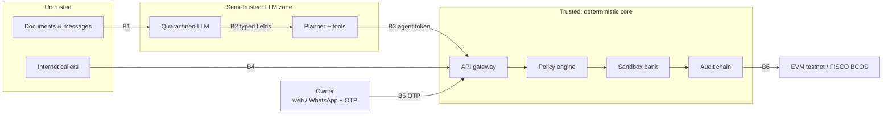

# Threat model (r4-01)

**Owner:** Andy · **Method:** STRIDE per trust boundary + OWASP Top 10 for LLM Applications (2025) · **Status:** v2, Oct 10, against branch `andy` (policy engine, OTP, BEC, guard, privacy). Red team: [../04-source-code/redteam/results/REPORT.md](../04-source-code/redteam/results/REPORT.md)

Feeds the Security Self-Assessment Report (deliverable 05) and the red team (r4-06). Everything is synthetic data in a sandbox bank; the threats are modelled as if it were real, because that is what the jury scores.

## What we protect

| Asset | Why it matters |
|-------|----------------|
| Money in the company's accounts | The agent can pay, convert FX, factor invoices and take loans. |
| Approval authority (owner + OTP) | The only thing standing between the agent and new debt. |
| Payee master data (bank accounts) | Changing one account redirects every future payment (BEC). |
| Audit log integrity | Proof of who did what; anchored on-chain. |
| Policy and limits | Raising a limit silently turns L3 actions into L2. |
| Personal data | Owner phone, payroll, customer contacts (Ley 21.719, PIPL). |
| Provider keys | OpenRouter, Mistral, Zavu, ElevenLabs, anchor wallet. |

## Actors

| Actor | Can |
|-------|-----|
| Fake supplier / BEC fraudster | Send invoices and messages through any channel; spoof look-alike domains. |
| Malicious or compromised importer | Send payment notices with injected instructions. |
| The agent itself, once manipulated | Call every tool the agent has (confused deputy). |
| Anyone who reaches the public API | Call unauthenticated endpoints. |
| Voice impersonator | Clone the owner's voice. |
| Curious insider / leaked repo | Read keys, logs, personal data. |

## Trust boundaries

- **B1** untrusted text enters an LLM · **B2** LLM output enters the planner · **B3** the planner asks for actions · **B4** the public API · **B5** human approval · **B6** anchoring.

## STRIDE

| # | Threat | Boundary | Control | Status |
|---|--------|----------|---------|--------|
| S1 | Owner approval spoofed by a cloned voice | B5 | Voice channels refused on approve; per-approval OTP by SMS | **Done** (r4-05) |
| S2 | Fake supplier on a look-alike domain | B1 | `domain-mismatch` + look-alike detection in `/security/check-payee` | **Done** (r4-04) |
| S3 | Caller pretends to be the agent | B3 | Bearer agent token, compared in constant time | Done; **open when the token is unset** (F6) |
| S4 | Caller pretends to be the owner | B4/B5 | Owner authentication | **Done** (F1): owner session on approve, reject, kill switch, reset |
| T1 | Supplier bank account swapped (BEC) | B1 | No tool takes a bank account; payee check vs history; account change is L3 + call-back; 72 h cooling-off | **Done** (r4-04) |
| T2 | Audit entry edited or deleted | B6 | Hash chain + Merkle anchor on-chain + `/audit/verify` | Done (Camilo) |
| T3 | Limits raised silently | B4 | Policy is code + data, versioned, logged in each decision | Done; no write API yet |
| T4 | Invoice financed twice | — | `financed_by` guard; on-chain registry later | Done off-chain (Camilo) |
| R1 | Owner denies approving | B5 | Audit entry with channel + OTP result, anchored | Done |
| R2 | Agent writes security entries in someone else's name | B3 | Actor derived from the token | **Done** (F7) |
| I1 | Personal data sent to LLM providers | B1 | `POST /privacy/mask` before any LLM call | **Done** (r4-07); Renato must call it |
| I2 | Ledger exfiltrated through a collection message | B3 | `send_collection` only to `contact_id`, templated; an invoice is only sent to its own customer | **Done** (Renato, `tools.py`) |
| I3 | API key leaked in the public repo | — | `.env` git-ignored, gitleaks in CI, spend limits | Done (Camilo) |
| D1 | Attacker burns the OTP attempts of a pending approval | B4 | 3 attempts then `locked`; owner re-requests | Lockout works; strangers are stopped by the owner session (F1) |
| D2 | Cost exhaustion through a loop of LLM calls | B3 | Max steps per run, spend limits | r2 (Renato) |
| D3 | Restart turns the kill switch off | B4 | — | **Open** (F9) |
| E1 | Prompt injection makes the agent move money | B1→B3 | Quarantine + guard + policy outside the LLM + OTP | Policy, guard (`/security/scan`), OTP done; quarantine → Renato |
| E2 | Split payments to stay under L2 | B3 | Request total, structuring, daily/monthly, velocity | **Done** (policy engine) |
| E3 | Agent approves its own L3 request | B3→B5 | Agent token refused on approve/reject; per-approval OTP never logged | **Done** (r4-05) |
| E4 | Anyone turns the kill switch off | B4 | Agent cannot re-arm itself; owner auth for the rest | Agent: **done**; anonymous: **done** (F1, session + one-time code) |

## OWASP Top 10 for LLM Applications (2025)

| Id | Risk | How NanFeng handles it | Status |
|----|------|------------------------|--------|
| LLM01 | Prompt injection | Quarantined LLM with typed output, spotlighting, guard, policy outside the LLM | **Done**: guard + quarantine with a random boundary per document (`04-source-code/agent/nanfeng_agent/quarantine.py`) + policy; 21 attacks through the agent, none moves money |
| LLM02 | Sensitive information disclosure | PII masking before LLM calls; templated outbound messages | r4-07 |
| LLM03 | Supply chain | Pinned dependencies, licenses listed, only API models from known providers | **Done**: licenses of every library, font, dataset and service in the root README (r3-08); gitleaks in CI |
| LLM04 | Data and model poisoning | No fine-tuning; synthetic data only; documents never become instructions | N/A by design |
| LLM05 | Improper output handling | Schema validation (`extra=forbid`), no LLM text rendered as HTML or run as code | **Done**: every model output is a Pydantic model with `extra="forbid"` (`quarantine.py`, `ingest.py`, `tools.py`); outbound messages are templates |
| LLM06 | Excessive agency | Least-privilege tools, no free-form money/contact params, L0–L3 + OTP, kill switch | **Done**: tools take ids from master data only; collections only to the invoice's own customer |
| LLM07 | System prompt leakage | No secrets or limits in prompts; limits live in the policy engine | **Done**: the planner and extractor prompts hold no keys, limits or contacts (`planner.py`, `quarantine.py`) |
| LLM08 | Vector and embedding weaknesses | No RAG in scope | N/A |
| LLM09 | Misinformation | The LLM never computes numbers; every figure carries its `source` tool | Done (Vicente's tools) |
| LLM10 | Unbounded consumption | Max steps per run, OpenRouter spend caps, velocity limit on actions | **Done**: step cap and LLM spend cap halt the run (`orchestrator.py`), velocity rule in the policy engine |

## Findings in the current code

| # | Severity | Finding | Where | Fix | Owner · when |
|---|----------|---------|-------|-----|--------------|
| F1 | High | No owner authentication: anyone who reaches the API can approve (with the OTP), reject, turn the kill switch off or reset the bank. | `04-source-code/backend/app/routers/approvals.py:105`, `:140`, `:161`; `04-source-code/backend/app/routers/bank.py:64` | Owner session (HMAC-signed, 8 h) on these routes; kill switch off needs session + one-time code; reset only with NANFENG_DEMO=true | Camilo · **fixed** (`4453927`, `74528af`) |
| F2 | High | OTP is one static code shared by every approval, not bound to the amount or the approval, no server-side expiry, printed on screen. | `04-source-code/backend/app/config.py`; `04-source-code/web/src/app/(desk)/approvals/page.tsx:151` | `NANFENG_OTP_MODE=sms`: random code per approval, HMAC-bound to approval + amount, 5 min TTL, single use, sent by Zavu | Andy · **fixed** in SMS mode; the public demo must run with `sms` |
| F3 | High | Split payments and cumulative spend were not checked: each operation was evaluated alone. | old `04-source-code/backend/app/policy.py` | Policy engine with request total, structuring, 24 h / 30 d limits, velocity, L3 caps | Andy · **fixed** (r4-02) |
| F4 | Medium | Front and back disagreed on limits (L2 CLP 25M on screen, 10M in the backend). | `04-source-code/web/src/app/(desk)/settings/page.tsx:10` vs old policy | Engine uses the Settings values; `GET /policy` is the source of truth for the front | Andy · **fixed**; Settings reads `GET /policy` in live mode (Oct 12) |
| F5 | Medium | A payee has one bank account and no history, so an account change cannot be detected. | `04-source-code/backend/app/models.py` (`Payee`) | `payee_accounts` history, `payee_profiles`, `/security/check-payee` | Andy · **fixed** |
| F6 | Medium | Agent token check is open when the token is empty; `.env.example` ships `change-me`. | `04-source-code/backend/app/security.py:11` | Fail closed: no token = 401 (`NANFENG_ALLOW_OPEN_AGENT=true` for local dev only); the `change-me` placeholder is refused at startup | Andy · **fixed** (Oct 12) |
| F7 | Medium | `POST /audit/entries` takes `actor` from the request body, so the agent can log entries as `owner`. | `04-source-code/backend/app/routers/audit.py` | Actor recorded as `agent[:label]` | Andy · **fixed** |
| F8 | Low | Policy decisions and executions could race between concurrent requests. | `04-source-code/backend/app/routers/approvals.py` | One lock around decide + execute (single instance) | Andy · **fixed** |
| F9 | Medium | Kill switch lives in memory: a restart silently turns the agent back on (fails open). | `04-source-code/backend/app/routers/approvals.py:20` | Stored in the database (`app_state`); a restart keeps it on | Camilo · **fixed** (`74528af`) |
| F10 | Low | Kill switch only stops money operations, not the agent's other steps. | `04-source-code/backend/app/routers/approvals.py` | Orchestrator checks it before every step and halts the run (`04-source-code/agent/nanfeng_agent/orchestrator.py`, tested mid-run) | Renato · **fixed** |
| F11 | Low | Read endpoints (`/audit/entries`, `/bank/*`) are public. Fine with synthetic data, not with real data. | routers | Owner session on reads once F1 lands | Camilo · after freeze |
| F12 | Medium | Every payment wrote the payee's full bank account into the public audit log (red team EX-04). | `04-source-code/backend/app/bank.py` | Last four digits only | Andy · **fixed** |
| F13 | Medium | `POST /audit/anchor` was open to anyone, and every anchor writes a new `audit.anchored` entry, so there was always something pending: an anonymous caller could send unlimited transactions from the anchoring wallet (found Oct 12: 5 anonymous calls, 5 anchors). | `04-source-code/backend/app/routers/audit.py` | Agent token or owner session required | Andy · **fixed** (Oct 12) |
| F14 | Low | The OTP attempt counter was a read-modify-write: wrong codes sent in parallel each saw "3 attempts left" (40 at once: 17 compared), and a right code among them could still win after the attempts were spent. | `04-source-code/backend/app/routers/approvals.py` (`approve`) | Reserve the attempt with an atomic conditional UPDATE before comparing; no comparison once spent | Andy · **fixed** (Oct 13) |

## Residual risks we will declare (deliverable 05)

- The guard classifier is probabilistic; we rely on the policy engine and the OTP, not on it.
- Single-instance backend: the lock, SSE history and kill switch do not survive horizontal scaling.
- SIM-swap against the owner's phone would defeat SMS OTP; production would add device binding or an authenticator app.
- Sandbox only: no real bank API, so bank-side controls (callbacks, limits) are simulated.
