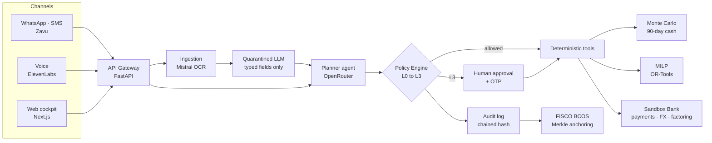

# Stack

> Planning document (Oct 7). The system as built, with the hosts and the tools actually used, is in [docs/technical-documentation.md](../docs/technical-documentation.md#2-system-architecture). Some tools below were not used: shadcn/ui, Supabase, promptfoo / garak; FISCO BCOS is replaced by Sepolia for now.

The four marked **(given)** are the ones we already have. The rest is open source or has a free plan; everything must be listed with its license in the README (IP rule of the competition).

| Tool | Area | What it's for |
|------|------|---------------|
| **Zavu** (given) | Messaging | WhatsApp, SMS, voice and email with one API. Alerts, approvals, OTP and collections to the importer. Webhooks to receive invoices over WhatsApp. |
| **OpenRouter** (given) | LLM router | Cheap model to classify, strong one to plan, and fallback if a provider goes down. We show cost and latency per task in the UI. |
| **Mistral** (given) | OCR + LLM | Mistral OCR for invoices, bank statements and receipts (including invoices in Chinese). Small model as quarantined LLM that only extracts fields. |
| **ElevenLabs** (given) | Voice | Daily cash briefing by voice and alert call. Trilingual. Never approves L3 actions (deepfake risk). |
| Next.js + Tailwind + shadcn/ui | Front | Web cockpit deployed on Vercel. Recharts or visx for the fan chart. |
| FastAPI + Postgres | Back | API, sandbox bank and agent event stream (SSE). Supabase for database and auth. |
| NumPy + OR-Tools | Quant | Monte Carlo simulation and financing MILP optimizer. |
| FISCO BCOS | On-chain | Consortium blockchain driven by WeBank. Merkle anchoring of the audit log. Fallback: EVM testnet. |
| promptfoo / garak | Red team | Automated suite of injection and tool-abuse attacks, with metrics for the report. |

## Architecture

## Module ownership

| Module | Owner |
|--------|-------|
| Web cockpit (channels → Web) | Valentín + Camilo |
| API Gateway, Sandbox Bank, audit log, FISCO BCOS | Camilo |
| Ingestion, quarantined LLM, planner agent, tools, Zavu/ElevenLabs channels | Renato |
| Policy engine, human approval + OTP, anti-injection design, red team | Andy |
| Monte Carlo, MILP, financial catalog, NanFeng-Bench | Vicente |
