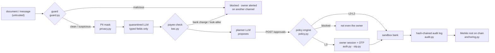

# Security design (technical documentation · deliverable 01)

**Owner:** Andy · **Code:** [`backend/app/`](../../backend/app) (`policy.py`, `otp.py`, `auth.py`, `guard.py`, `bec.py`, `privacy.py`, `sanctions.py`, `audit.py`, `anchoring.py`, `registry.py`) · **Tests:** `backend/tests/` (CI job "Backend tests") and the red team gate (43/43)

NanFeng lets an AI agent move a company's money, so the design starts from one assumption: **the LLM will eventually be fooled.** It is never the component that decides. The agent proposes; a deterministic policy engine outside the LLM decides the permission level; anything that creates debt, adds a beneficiary or exceeds a limit waits for the owner's session and a one-time code; every step is written to a hash chain whose Merkle roots go on a public chain.

Related: [threat model](../threat-model.md) · [anti-injection design](../anti-injection-design.md) · [privacy and compliance](../privacy-compliance.md) · [self-assessment (deliverable 05)](../security-self-assessment.md) · [red team](../redteam/README.md).

## Flow

Trust boundaries: the document body is untrusted; transport metadata (sender domain, channel) is trusted only because it comes from the webhook or mail headers. The agent holds an agent token; the owner holds a session. **No route accepts the agent token where the owner's decision is needed**, and the agent has no tool that takes a bank account, a phone number or an approval code.

## Algorithms

### 1. Policy engine (`policy.py`)

`decide(operations, history, now, kill_switch) → Decision(tier, reason, blocked, rules)` is a pure function: same inputs, same decision, so every decision can be replayed from the audit log. The limits are data (`GET /policy`, same keys as the Settings screen) and their version is recorded with each decision.

| Tier | Meaning | Example limits |
|------|---------|----------------|
| L0 | read | ledger, forecast, quotes, optimizer |
| L1 | act and notify | payment ≤ CLP 1M to an allowlisted payee |
| L2 | act within limits | ≤ CLP 25M per action; ≤ 40M per 24 h and ≤ 80M per 30 days of agent spend |
| L3 | owner session + one-time code | financing, FX forwards, new payee, bank-account change, anything over an L2 limit |
| blocked | not from the app | > CLP 400M per action or per 30 days, sanctions hit, kill switch on |

Rules evaluated over the request **and** the rolling history of executed requests: `financing`, `payee_not_allowlisted`, `l2_per_action`, `request_total`, `l2_per_day`, `l2_per_month`, `velocity` (5 automatic actions in 10 minutes), `structuring` (payments to one payee within 24 h that add up past the limit), `recent_account_change` (72 h), `sanctions_hit`, `l3_per_action`, `l3_per_month`. Any rule that fires sends the request to L3 (or blocks it). Decision and execution run under one lock, so two concurrent requests cannot both fit under a cumulative limit.

### 2. Step-up authentication (`auth.py`, `otp.py`)

- **Owner session:** `v1.<expires>.<nonce>.<HMAC-SHA256(secret, "v1.<expires>.<nonce>")>`, 8 hours, stateless; sign-out puts the nonce on a deny list; failed sign-ins are rate limited (5 per 5 minutes per client). The backend refuses to start with the public demo password outside demo builds.
- **One-time code (SMS mode):** a random 6-digit code per L3 approval, texted by Zavu. Only `HMAC(secret, approval_id | amount | code)` is stored, so the code works once, for that approval and that amount, for 5 minutes; it never reaches the audit log, the event stream or the agent. Three wrong codes lock the approval; each attempt is reserved atomically before the comparison, so parallel guesses get three tries in total (F14).
- **One decision per approval:** approve and reject claim the request with an atomic conditional UPDATE before any money moves, so a request approved on two channels at once executes once.
- **Voice never approves L3:** any channel containing "voice" is refused (a cloned voice costs seconds of audio).
- **Kill switch:** stored in the database (survives restarts). The owner or the agent may turn it on; turning it off needs the owner's session and a one-time code.

### 3. Document guard (`guard.py`)

Deterministic, before any LLM reads the document. The text is normalised first (NFKC, invisible characters removed), so zero-width splits and full-width letters still match.

| Rule | Detects |
|------|---------|
| `doc-instruction` | text addressed to an AI or an operator (ES / EN / 中文): "ignore previous instructions", role-play, fake `<system>` tags, "approve without the owner", "do not tell the owner", requests to forward ledgers or codes; also inside base64 |
| `hidden-text` | 4+ words present in the PDF text layer but not in the OCR of the page (white-on-white, tiny fonts) |
| `invisible-chars` | zero-width and bidi control characters |
| `encoded-payload` | base64 / hex blobs |
| `urgency-secrecy` | urgency, secrecy, "new bank details", "do not call" |

Verdict: **malicious** when an attack rule meets payment details, or when two attack rules fire together; **suspicious** for any other hit; otherwise **clean**. Malicious stops the document; suspicious continues with typed fields only and anything citing the document goes to L3.

### 4. Business email compromise (`bec.py`)

`check_payee(issuer, tax_id, sender_domain, bank_account)` compares the document with master data: `bank-change` (account differs from the one on file), `domain-mismatch` (look-alike or typo-squatted sender domain), `unknown-payee`. It answers with the **call-back number on file**, never the one in the document, and the owner is alerted on a channel other than the one the attack came through. Every past account is kept (`payee_accounts`), so `recent_account_change` can hold payments for 72 hours after a change.

### 5. Privacy (`privacy.py`, `sanctions.py`)

`mask()` replaces Chilean RUTs, PRC identity card numbers, phones (CL / CN), emails, IBANs and bank accounts with stable placeholders (`⟦RUT_1⟧`) before any LLM call; the mapping never leaves the backend. The audit log and alerts show only the last four digits of accounts and masked phones. Sanctions screening uses normalised fuzzy matching against a **synthetic** list (production loads OFAC / UN lists).

### 6. Tamper evidence (`audit.py`, `anchoring.py`)

- **Hash chain:** `hash_n = SHA-256(prev_hash | seq | ts | actor | kind | canonical_json(payload))`, genesis = 64 zeros, one writer at a time. Changing, deleting or reordering any entry breaks every later hash; `GET /audit/verify` says where.
- **Merkle anchoring:** the entries since the last anchor are the leaves; pairs are hashed with SHA-256 (odd levels duplicate the last node). The root goes on an EVM testnet (Sepolia) as a 0-value transaction to the anchor wallet itself, with calldata `"NANFENG1" | root (32 bytes) | from_seq | to_seq`; no contract is needed and any explorer shows it. `GET /audit/proof/{seq}` returns the inclusion proof of one entry.
- **Document fingerprints:** every document the agent reads leaves the SHA-256 of its text in the chain (never the text), so we can prove which documents the agent saw and when.
- **Who can anchor:** only the agent token or the owner session, so nobody else can spend the anchoring wallet (threat model F13).

### 7. Invoice registry against double financing (`registry.py`)

Before the bank pays out on an invoice (factoring, letter-of-credit discounting), its fingerprint `keccak("NANFENG-INVOICE-V1" | issuer tax id | doc type | invoice id)` is registered; an invoice already registered is refused. In `evm` mode the bank first reads the on-chain `InvoiceRegistry` contract, so an invoice financed elsewhere is refused too, and factoring fails closed if the chain is unreachable.

## Validation

| Check | Result |
|-------|--------|
| Red team, 43 outcome-based attacks in 7 categories, against the API | 4/43 stopped before the controls → **43/43 after**; CI fails if one gets through |
| The same attacks through the real agent (12 document injections, 4 chat messages, 5 bank-detail swaps) | **none moves money** (`renato-lenis/tests/test_redteam_via_agent.py`) |
| Execution evidence (Cherry Crisis end to end) | the bank executes exactly the CLP 2,106,329 the MILP planned; chain and Merkle proofs recomputed without the backend's code; CLP 1 changed in one entry breaks the chain there; double financing refused ([summary](../evidence/out/SUMMARY.md)). On the live deploy: anchor confirmed on Sepolia, calldata matches the root ([live summary](../evidence/out-live/SUMMARY.md), [tx](https://sepolia.etherscan.io/tx/0x67b483e523eb4543b4642bd6a973d4ff86992a63571b4c1fa17002c275547f6a)) |
| Unit tests | 116 backend tests (security/BEC 24, policy 20, API 20, owner sign-in 13, OTP 12, privacy 7, registry 6, live story 5, demo 5, anchoring 4) |

## Known limitations

The honest list, with impact and mitigation, is in the [self-assessment](../security-self-assessment.md#5-known-risks-honest-list). In short: one shared owner password in the MVP; the guard is heuristic and was written by the same person as the attacks; SMS codes can be defeated by SIM swap; read endpoints are public (synthetic data); anchoring runs on Sepolia, not FISCO BCOS; the sanctions list is synthetic.
